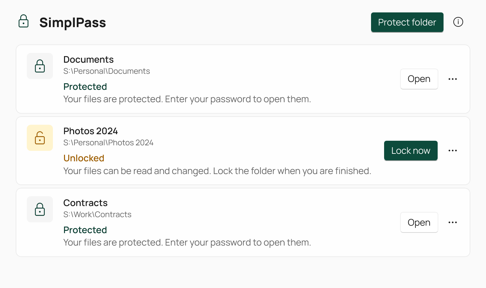

# SimplPass

[](https://github.com/AdamAnomatik/SimplPass-Releases/releases/latest)
[](https://github.com/AdamAnomatik/SimplPass-Releases/releases)
[](https://github.com/AdamAnomatik/SimplPass-Releases/releases/latest)

**English** · [Русский](README.ru.md)

<p align="center">
  
</p>

SimplPass protects the contents of a folder with a password, right on your computer. The folder stays where it is and its file names stay visible in File Explorer, while the contents are encrypted. When an app opens a file, SimplPass asks for the password; when you are done, you lock the folder again.

## Features

- Protect any regular folder in place: no container files and no drive letters.
- File and folder names stay visible while locked; file contents are encrypted (AES-256-GCM, key derived from your password with Argon2id).
- A compact password prompt says which app is opening which file from which folder, and warns about Caps Lock.
- Lock a folder with one click, or right-click it in File Explorer and choose **Protect with SimplPass**.
- SimplPass tries to lock open folders when Windows locks your session.
- Clear states at a glance: Protected, Open, and Operation interrupted, with safe recovery.
- Remove protection at any time: the folder becomes an ordinary Windows folder again.
- Native Windows 11 look that follows the light and dark theme.
- Russian and English interface, following the Windows language.
- Fully offline: no account, server, telemetry, ads or subscription.

## Download

The latest stable version is available in Releases.

➡️ [Download the latest SimplPass version](https://github.com/AdamAnomatik/SimplPass-Releases/releases/latest)

[View all versions](https://github.com/AdamAnomatik/SimplPass-Releases/releases)

### What to download

- `SimplPass-x.y.z-win-x64-setup.exe` — application installer.
- `SimplPass-x.y.z-win-x64-setup.exe.sha256` — SHA-256 checksum for installer verification.

## System requirements

- 64-bit Windows 10 version 2004 (build 19041) or later, or Windows 11.
- A fixed local NTFS drive for protected folders. Network, removable and cloud-synced drives are not supported.
- The official Dokany 2.3.1.1000 driver. If it is missing, Setup installs the unmodified signed package and asks for administrator approval once.

The installer is self-contained and does not require a separate .NET installation.

## Installation

1. Download the latest `SimplPass-x.y.z-win-x64-setup.exe` file.
2. Run the installer and follow the setup wizard.
3. Open SimplPass from the Start menu and choose **Protect folder**, or right-click a folder in File Explorer and choose **Protect with SimplPass** (on Windows 11 it is under **Show more options**).

SimplPass is installed for the current user:

```text
%LOCALAPPDATA%\Programs\SimplPass
```

## Before you start

- **A forgotten password cannot be recovered.** Nobody, including SimplPass, can open the files without it.
- Keep a separate backup of important files. Try SimplPass on a copy first.
- SimplPass has not had an independent security audit. It protects file contents on a locked folder; it does not protect an open folder from malware, and it does not erase data permanently. Use full-disk encryption such as BitLocker to protect a stolen computer.
- Files deleted inside a protected folder do not go to the Recycle Bin.
- The installer is not digitally signed, so Windows SmartScreen may show a warning on first launch.

## Where data is stored

Settings and the encrypted data of protected folders are stored locally:

```text
%LOCALAPPDATA%\SimplPass
```

Uninstalling SimplPass keeps this data; reinstall SimplPass to reconnect your protected folders.

## Update

Run the new installer over the previous version. Protected folders and settings are preserved. Close files opened from protected folders first.

## SHA-256 verification

After downloading the installer, you can check its checksum in PowerShell:

```powershell
Get-FileHash .\SimplPass-x.y.z-win-x64-setup.exe -Algorithm SHA256
```

The result must match the published `SimplPass-x.y.z-win-x64-setup.exe.sha256` file.

## Report a problem

Found a problem or want to suggest an improvement?

➡️ [Create an issue](https://github.com/AdamAnomatik/SimplPass-Releases/issues/new)

Please include:

- the SimplPass version;
- the Windows version;
- steps to reproduce the problem;
- a screenshot if it helps. Never include your password.

The source code is private and is not included in this repository. See [LICENSE](LICENSE).


