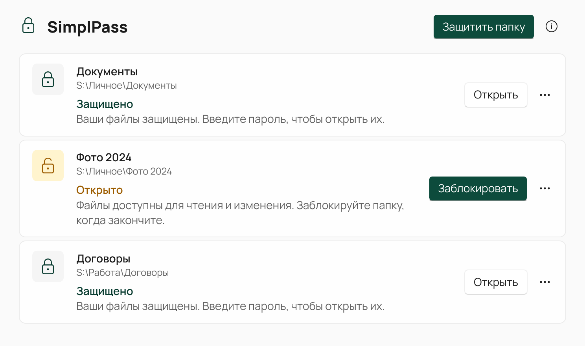

# SimplPass

[](https://github.com/AdamAnomatik/SimplPass-Releases/releases/latest)
[](https://github.com/AdamAnomatik/SimplPass-Releases/releases)
[](https://github.com/AdamAnomatik/SimplPass-Releases/releases/latest)

[English](README.md) · **Русский**

<p align="center">
  
</p>

SimplPass закрывает содержимое папки паролем прямо на вашем компьютере. Папка остаётся на своём месте, имена файлов видны в Проводнике, а их содержимое зашифровано. Когда программа открывает файл, SimplPass спрашивает пароль; закончив работу, вы снова блокируете папку.

## Возможности

- Защита любой обычной папки на месте: без файлов-контейнеров и букв дисков.
- Имена файлов и папок видны и в заблокированной папке, содержимое файлов зашифровано (AES-256-GCM, ключ из пароля по Argon2id).
- Компактное окно пароля показывает, какая программа открывает какой файл и из какой папки, и предупреждает о включённом Caps Lock.
- Блокировка папки одной кнопкой или через Проводник: правый щелчок по папке → **Защитить с SimplPass**.
- При блокировке сеанса Windows SimplPass старается заблокировать открытые папки.
- Понятные состояния: «Защищено», «Открыто», «Операция прервана» — с безопасным восстановлением.
- Снять защиту можно в любой момент: папка снова станет обычной папкой Windows.
- Родной вид Windows 11 со светлой и тёмной темой.
- Интерфейс на русском и английском — по языку Windows.
- Полностью локальная работа: без учётной записи, серверов, телеметрии, рекламы и подписок.

## Скачать

Последняя стабильная версия доступна в разделе Releases.

➡️ [Скачать последнюю версию SimplPass](https://github.com/AdamAnomatik/SimplPass-Releases/releases/latest)

[Все версии](https://github.com/AdamAnomatik/SimplPass-Releases/releases)

### Что скачать

- `SimplPass-x.y.z-win-x64-setup.exe` — установщик приложения.
- `SimplPass-x.y.z-win-x64-setup.exe.sha256` — контрольная сумма SHA-256 для проверки загруженного файла.

## Системные требования

- 64-разрядная Windows 10 версии 2004 (сборка 19041) или новее либо Windows 11.
- Для защищённых папок — локальный несъёмный диск NTFS. Сетевые, съёмные и облачные диски не поддерживаются.
- Официальный драйвер Dokany 2.3.1.1000. Если его нет, установщик поставит неизменённый подписанный пакет и один раз запросит права администратора.

Установщик self-contained: отдельная установка .NET не требуется.

## Установка

1. Скачайте последний файл `SimplPass-x.y.z-win-x64-setup.exe`.
2. Запустите установщик и следуйте шагам мастера.
3. Откройте SimplPass из меню «Пуск» и нажмите **Защитить папку** или щёлкните папку правой кнопкой в Проводнике и выберите **Защитить с SimplPass** (в Windows 11 — в разделе **Показать дополнительные параметры**).

Установка выполняется для текущего пользователя:

```text
%LOCALAPPDATA%\Programs\SimplPass
```

## Перед началом

- **Забытый пароль восстановить нельзя.** Без него файлы не откроет никто, включая SimplPass.
- Храните отдельные копии важных файлов. Сначала попробуйте SimplPass на копии.
- SimplPass не проходил независимый аудит безопасности. Он защищает содержимое заблокированной папки, но не защищает открытую папку от вредоносных программ и не стирает данные безвозвратно. Для защиты при краже компьютера используйте полное шифрование диска, например BitLocker.
- Файлы, удалённые из защищённой папки, не попадают в Корзину.
- Установщик не подписан цифровой подписью, поэтому Windows SmartScreen может показать предупреждение при первом запуске.

## Где хранятся данные

Настройки и зашифрованные данные защищённых папок хранятся локально:

```text
%LOCALAPPDATA%\SimplPass
```

При удалении SimplPass эти данные сохраняются; чтобы снова подключить защищённые папки, установите SimplPass заново.

## Обновление

Новый установщик можно запускать поверх предыдущей версии. Защищённые папки и настройки сохраняются. Перед обновлением закройте файлы, открытые из защищённых папок.

## Проверка SHA-256

После загрузки установщика можно проверить его контрольную сумму в PowerShell:

```powershell
Get-FileHash .\SimplPass-x.y.z-win-x64-setup.exe -Algorithm SHA256
```

Полученное значение должно совпадать с опубликованным файлом `SimplPass-x.y.z-win-x64-setup.exe.sha256`.

## Сообщить об ошибке

Обнаружили проблему или хотите предложить улучшение?

➡️ [Создать обращение](https://github.com/AdamAnomatik/SimplPass-Releases/issues/new)

При описании ошибки укажите:

- версию SimplPass;
- версию Windows;
- шаги для воспроизведения;
- скриншот, если он помогает понять проблему. Никогда не присылайте свой пароль.

Исходный код закрыт и в этот репозиторий не входит. См. [LICENSE](LICENSE).


